<a href="https://manyakaistha.github.io/manyakaistha/"><picture><source media="(prefers-reduced-motion: reduce)" srcset="assets/hero-still.svg" /></picture></a>

  <a href="https://manyakaistha.github.io/manyakaistha/"><strong>Open the observatory ↗</strong></a> &nbsp;·&nbsp;
  <a href="#selected-work">Selected work</a> &nbsp;·&nbsp;
  <a href="#how-i-work">How I work</a> &nbsp;·&nbsp;
  <a href="mailto:manyakaistha.dev@gmail.com">Say hello ↗</a>

The sky above is my last year on GitHub, rebuilt every night: one star per day, brighter trails for busier days. In the observatory, hold to open the shutter, shake the camera, and let go to watch it align.

### Hi, I'm Manya.

I build across **machine learning, research, and product interfaces** — from asking questions of data to aligning night-sky images, exploring graphs, and making reading feel different. I care about the whole journey: the idea, the evidence behind it, and the interface that makes it useful.

## Selected work

<a href="https://github.com/manyakaistha/PullStar"><picture><source media="(prefers-reduced-motion: reduce)" srcset="assets/pullstar-still.svg" /></picture></a>

**Correct camera wobble while preserving the sky's natural rotation.** Export aligned frames for another editor, or create star-trail images and videos in the same local workspace.

**[Download for macOS ↗](https://github.com/manyakaistha/PullStar/releases/latest)** &nbsp;·&nbsp; [Explore PullStar](https://github.com/manyakaistha/PullStar) &nbsp;·&nbsp; [MCP integration](https://github.com/manyakaistha/PullStar/blob/main/docs/mcp-server.md)

<strong>Inside PullStar</strong>

`Night-sky frames → alignment → images or trails`

Automatic star-field matching works without Polaris in the frame; manual reference tracking is also available. Export aligned TIFF, PNG, or JPEG sequences, build trails, or render video. Processing stays on your computer, and the bundled MCP server supports inspection, previews, exports, and background jobs.

<table>
<tr>
<td width="50%" valign="top">

<a href="https://github.com/manyakaistha/nl-analytics-query-engine"><picture><source media="(prefers-reduced-motion: reduce)" srcset="assets/analytics-still.svg" /></picture></a>

**Ask a question. Inspect the calculation.** A natural-language analytics workspace with visible SQL, result tables, and evaluation evidence.

<strong>Inside the build</strong>

The interesting part is the handoff from generated SQL to bounded, read-only execution. The project also separates historical model evaluations from current offline software checks.

</td>
<td width="50%" valign="top">

<a href="https://github.com/manyakaistha/touchline-fifa-worldcup-hybrid-graph-rag"><picture><source media="(prefers-reduced-motion: reduce)" srcset="assets/touchline-still.svg" /></picture></a>

**World Cup questions, connected to sources.** A local-first evidence workbench combining graph and semantic retrieval with an explorable knowledge graph.

<strong>Inside the build</strong>

Graph and semantic retrieval can be explored independently or combined. Source passages stay visible, and hosted answer generation is an explicit option.

</td>
</tr>
<tr>
<td width="50%" valign="top">

<a href="https://github.com/manyakaistha/Flux-Reader"><picture><source media="(prefers-reduced-motion: reduce)" srcset="assets/flux-still.svg" /></picture></a>

**A different rhythm for reading.** A PDF and EPUB reader with word-by-word playback, adjustable pace, and a local library that remembers your place.

<strong>Inside the build</strong>

PDF and EPUB extraction feed a word-by-word reader. Adjustable pacing, context when paused, and locally saved progress support the reading experience.

</td>
<td width="50%" valign="top">

<a href="https://github.com/manyakaistha/faceinsight"><picture><source media="(prefers-reduced-motion: reduce)" srcset="assets/faceinsight-still.svg" /></picture></a>

**From model output to model understanding.** A vision research studio bringing together local inference, Grad-CAM explanations, and saved evaluations.

<strong>Inside the build</strong>

The workbench connects local vision inference with Grad-CAM overlays. Model interpretation and the limitations of saved evaluations are part of the project.

</td>
</tr>
<tr>
<td width="50%" valign="top">

<a href="https://github.com/manyakaistha/The-Sequential-Matching-Problem-Final"><picture><source media="(prefers-reduced-motion: reduce)" srcset="assets/matching-still.svg" /></picture></a>

**Who to introduce, and when?** Research on reciprocal matching with delayed feedback, synthetic simulations, and a report that documents results and limitations.

<strong>Inside the build</strong>

Which information should a policy request before introducing a pair? The report records the experiments and retains the Greedy baseline because the tested alternatives did not establish superiority.

</td>
<td width="50%" valign="top">

<a href="https://manyakaistha.github.io/DLGenAI-26T3/"><picture><source media="(prefers-reduced-motion: reduce)" srcset="assets/learning-still.svg" /></picture></a>

**Make the difficult ideas easier to explore.** Study guides, interactive lessons, and notebooks on segmentation, data pipelines, and transfer learning.

<strong>Inside the build</strong>

Interactive explanations sit alongside notebooks and study guides. Readers can move from visual intuition to code, then into a concrete experiment.

</td>
</tr>
</table>

<strong>A little further into the workshop</strong>

- [Understanding Deep Learning RAG](https://github.com/manyakaistha/understanding-deep-learning-rag) — a local-first study tutor with handwritten hybrid retrieval and inspectable citations.
- [RSNA knee MRI](https://github.com/manyakaistha/rsna-knee-mri) — weak supervision, anatomical ROI modelling, and distributed training.
- [AudioFake](https://github.com/manyakaistha/AudioFake) — real-time audio deepfake detection.
- [Protein secondary structure prediction](https://github.com/manyakaistha/helixq-protein-folding) — sequence models and residue-level visualizations.
- [Browse all repositories](https://github.com/manyakaistha?tab=repositories) — experiments, notebooks, and work in progress.

## How I work

**Make the reasoning inspectable.** Show the SQL, retrieve the source, visualize the model, and document the experiment.

**Give the interface the same care as the engine.** Typography, interaction, and clarity shape how people understand a system.

**Keep learning in public.** Turn investigations into projects, notebooks, and resources someone else can explore.

Python · PyTorch · FastAPI · SQL · DuckDB &nbsp;/&nbsp; TypeScript · React Native · Expo · Next.js

<a href="mailto:manyakaistha.dev@gmail.com"><picture><source media="(prefers-reduced-motion: reduce)" srcset="assets/footer-still.svg" /></picture></a>
