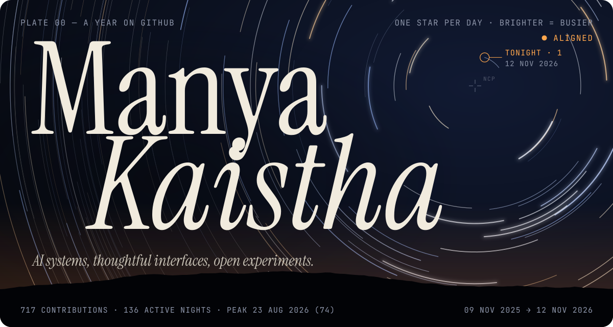
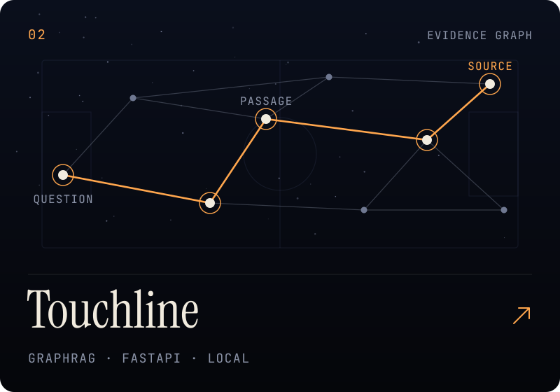
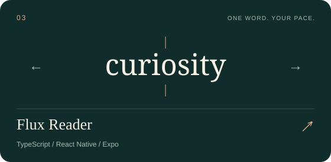
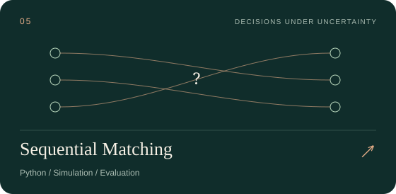
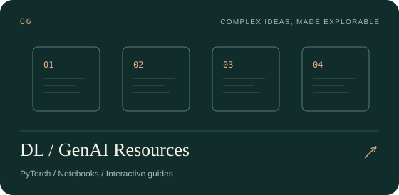
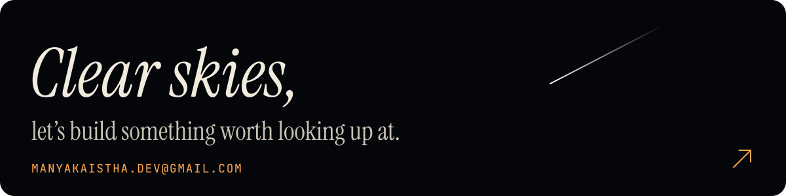

  

  <a href="#selected-work">Selected work</a> &nbsp; / &nbsp;
  <a href="#what-connects-it-all">Approach</a> &nbsp; / &nbsp;
  <a href="https://manyakaistha.github.io/DLGenAI-26T3/">Learning resources</a> &nbsp; / &nbsp;
  <a href="mailto:manyakaistha.dev@gmail.com">Say hello ↗</a>

Take a trail through the workshop · <a href="https://github.com/manyakaistha">Return to the animated profile</a>

### Hi, I'm Manya.

I build across **machine learning, research, and product interfaces** — from asking questions of data to exploring graphs, interpreting models, and making reading feel different.

I'm interested in the whole journey: the underlying idea, the evidence that supports it, and the interface that makes it useful.

## Pick a trail

<strong>01 · Follow a question into an AI system</strong>

Start with [Analytics Query Engine](https://github.com/manyakaistha/nl-analytics-query-engine) to follow a question into SQL and results. Then explore [Touchline](https://github.com/manyakaistha/touchline-fifa-worldcup-hybrid-graph-rag), where passages and graph relationships make the evidence visible.

<strong>02 · Look inside an experiment</strong>

Explore [Sequential Matching](https://github.com/manyakaistha/The-Sequential-Matching-Problem-Final) for decisions with delayed feedback, or [FaceInsight](https://github.com/manyakaistha/faceinsight) for visual explanations of model outputs.

<strong>03 · Try a different way to read or learn</strong>

Meet [Flux Reader](https://github.com/manyakaistha/Flux-Reader) for word-by-word reading, or visit the [DL / GenAI learning hub](https://manyakaistha.github.io/DLGenAI-26T3/) for interactive lessons and notebooks.

## Selected work

<table>
<tr>
<td width="50%" valign="top">

**Ask a question. Inspect the calculation.** A natural-language analytics workspace with visible SQL, result tables, and evaluation evidence.

[Analytics Query Engine ↗](https://github.com/manyakaistha/nl-analytics-query-engine)

<strong>Inside the build</strong>

`Question → SQL → result`

The interesting part is the handoff from generated SQL to bounded, read-only execution. The project also separates historical model evaluations from current offline software checks.

</td>
<td width="50%" valign="top">

**World Cup questions, connected to sources.** A local-first evidence workbench combining graph and semantic retrieval with an explorable knowledge graph.

[Touchline ↗](https://github.com/manyakaistha/touchline-fifa-worldcup-hybrid-graph-rag)

<strong>Inside the build</strong>

`Question → evidence → graph`

Graph and semantic retrieval can be explored independently or combined. Source passages stay visible, and hosted answer generation is an explicit option.

</td>
</tr>
<tr>
<td width="50%" valign="top">

**A different rhythm for reading.** A PDF and EPUB reader with word-by-word playback, adjustable pace, and a local library that remembers your place.

[Flux Reader ↗](https://github.com/manyakaistha/Flux-Reader)

<strong>Inside the build</strong>

`Document → words → reading rhythm`

PDF and EPUB extraction feed a word-by-word reader. Adjustable pacing, context when paused, and locally saved progress support the reading experience.

</td>
<td width="50%" valign="top">

**From model output to model understanding.** A vision research studio bringing together local inference, Grad-CAM explanations, and saved evaluations.

[FaceInsight ↗](https://github.com/manyakaistha/faceinsight)

<strong>Inside the build</strong>

`Image → prediction → explanation`

The workbench connects local vision inference with Grad-CAM overlays. Model interpretation and the limitations of saved evaluations are part of the project.

</td>
</tr>
<tr>
<td width="50%" valign="top">

**Who to introduce, and when?** Research on reciprocal matching with delayed feedback, synthetic simulations, and a report that documents results and limitations.

[Sequential Matching ↗](https://github.com/manyakaistha/The-Sequential-Matching-Problem-Final)

<strong>Inside the build</strong>

`Arrival → information → introduction`

Which information should a policy request before introducing a pair? The report records the experiments and retains the Greedy baseline because the tested alternatives did not establish superiority.

</td>
<td width="50%" valign="top">

**Make the difficult ideas easier to explore.** Study guides, interactive lessons, and notebooks on segmentation, data pipelines, and transfer learning.

[DL / GenAI learning hub ↗](https://manyakaistha.github.io/DLGenAI-26T3/)

<strong>Inside the build</strong>

`Concept → interaction → experiment`

Interactive explanations sit alongside notebooks and study guides. Readers can move from visual intuition to code, then into a concrete experiment.

</td>
</tr>
</table>

<strong>A little further into the workshop</strong>

- [Protein secondary structure prediction](https://github.com/manyakaistha/helixq-protein-folding) — sequence models and residue-level visualizations.
- [Phishing email classifier](https://github.com/manyakaistha/Phishing-Email-Classifier) — a DistilBERT-based classification CLI.
- [Browse all repositories](https://github.com/manyakaistha?tab=repositories) — experiments, notebooks, and work in progress.

## What connects it all

**Make the reasoning inspectable.** Show the SQL, retrieve the source, visualize the model, and document the experiment.

**Give the interface the same care as the engine.** Typography, interaction, and clarity shape how people understand a system.

**Keep learning in public.** Turn investigations into projects, notebooks, and resources someone else can explore.

  <strong>Tools across these projects</strong> 
  Python · PyTorch · FastAPI · SQL · DuckDB 
  TypeScript · React Native · Expo · Next.js

---

Have a question about a project, an idea to explore, or feedback to share? 
**[Get in touch ↗](mailto:manyakaistha.dev@gmail.com)** &nbsp; · &nbsp; [Explore the repositories](https://github.com/manyakaistha?tab=repositories)

